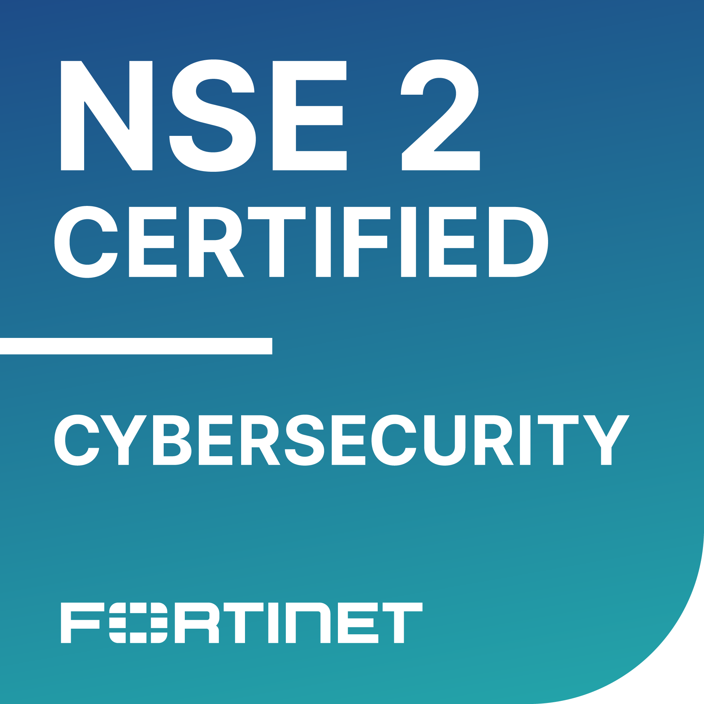

# 🏅 Certificación

| Campo | Detalle |
| ----- | ------- |
| **Certificación** | Fortinet NSE 2 — Certified in Cybersecurity |
| **Emisor** | Fortinet Training Institute |
| **Titular** | Juan Pablo Olivares Pérez |
| **Fecha** | _(completar)_ |
| **Vigencia** | 2 años desde la finalización del curso |
| **Verificación** | _(enlace público de la insignia, por ejemplo en Credly)_ |

## Evidencia

Coloca aquí tu certificado como `nse2-certificado.png` o `nse2-certificado.pdf`.

> 🔒 **Privacidad:** antes de subirlo, revisa que no muestre datos que no quieras hacer públicos
> (correo, identificadores, etc.). Si puedes, enlaza la **insignia pública** en lugar del archivo completo.

